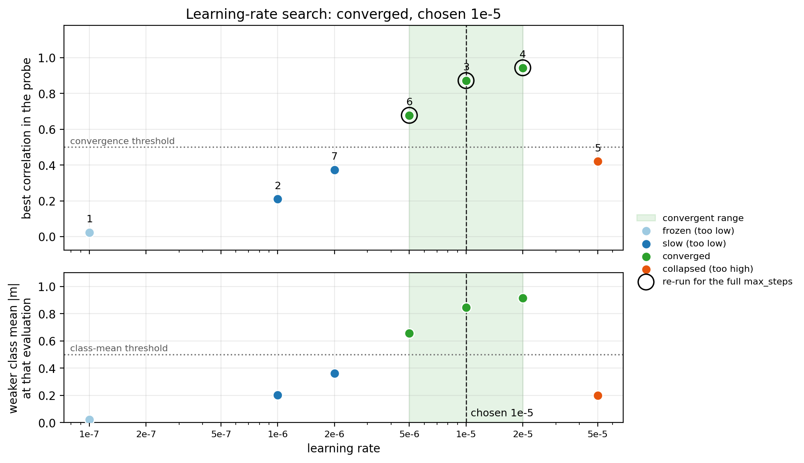

# Automatic learning-rate search

GRADIEND is sensitive to the learning rate. With `learning_rate="tune"`, `train()` first runs a few short probe
trainings, classifies each one (too slow, collapsed, diverged, converged, ...), moves the learning rate up or down
accordingly and then trains with the best value.

```python
args = TrainingArguments(learning_rate="tune", experiment_dir="runs/demo")
trainer = TextPredictionTrainer(model="bert-base-cased", data=data, args=args)
trainer.train()
```

To run the search on its own or change its options:

```python
result = trainer.tune_learning_rate(probe_steps=100)  # the next trainer.train() uses result.best_lr
```

- Each probe trains one seed from the base model for `probe_steps` steps; your trainer is left unchanged. With several
  seeds (`max_seeds`), the search runs once and all seeds use the result.
- An explicit `trainer.train(learning_rate=...)` always wins.
- If no learning rate converges, `NoConvergentLearningRate` is raised (check your data and setup); `error.result.probes`
  shows what each probe did. The search is saved in `lr_search.json` and reused with `use_cache=True`.
## How the search proceeds

1. Probe the starting value `initial_lr` (default: [`TrainingArguments`][gradiend.trainer.core.arguments.TrainingArguments].learning_rate, or `1e-5` for `"tune"`).
2. Move up or down by `factor` until one learning rate is too low (*slow*) and one too high (*collapsed* or *diverged*). That is the bracket.
3. Bisect inside the bracket on a coarse 1/2/5 grid to find learning rates that converge.
4. With `center_window`, walk outward from a convergent value to the edges of the convergent range and take the middle of it, which is safer than a value on the edge.
5. With `confirm`, re-run the chosen value for the full `max_steps` before accepting it.

## What the search did

`trainer.lr_search_result.plot()` draws it. The figure below is a simulation: nothing was trained, a made-up training response
was searched with the real search procedure, starting from `1e-7`.



**How to read it.** Each dot is one probe, a short training run at that learning rate, numbered in the order it ran. The colour is
the probe's state (table below). The top panel shows the best correlation between the encoded value and the class that the probe
reached; the bottom panel the weaker of the two class means at that point. A probe converges only if **both** reach their threshold
(dotted lines, `convergent_score_threshold` and `convergent_mean_by_class_threshold`, 0.5 each by default for the correlation metric): a high correlation alone
is not enough if the encoder has not yet moved both classes away from zero. A ring marks a probe that was re-run for the full
`max_steps`, the green band is the convergent range and the dashed line the chosen learning rate.

1. Probe 1 (`1e-7`): nothing moves, so the state is *frozen*. The search multiplies the learning rate by `factor` (10).
2. Probe 2 (`1e-6`): the encoder improves, but after the probe's 150 steps both values are far below their thresholds (*slow*). Also too low.
3. Probe 3 (`1e-5`): both thresholds are reached, so it converged and is confirmed with a full-length run. The search now walks along the 1/2/5 grid to find the edges of the convergent range.
4. Probe 4 (`2e-5`) converges too. Probe 5 (`5e-5`) overshoots: the correlation peaks at 0.42, then both classes drift onto the same side of zero (*collapsed*). That is the upper edge.
5. Probes 6 (`5e-6`) converges, probe 7 (`2e-6`) is slow: the lower edge.

The convergent range is `5e-6` to `2e-5`. The search chooses `1e-5`, its middle on the grid, instead of an edge value.

| State | What the probe did | Next step |
|---|---|---|
| `frozen` | nothing moved: score and class means stay flat | raise the learning rate |
| `slow` | improving, but below a threshold when the probe ended | raise it |
| `converged` | correlation and both class means reached their thresholds | accept (after `confirm`), then look at the neighbours |
| `degrading` | improved or started well, then got worse | lower it |
| `collapsed` | both classes ended on the same side of zero | lower it |
| `diverged` | the loss became non-finite | lower it |

<!-- DOC_PLOT: docs/img/lr_search_example.png
Regenerate: python scripts/plot_lr_search_example.py docs/img/lr_search_example.png
(simulated training response; for a real search call result.plot(output=...), or load a stored one with
LRSearchResult.from_dict(json.load(open(".../lr_search.json"))).plot())
-->

## Options

Set them with a [`LRSearchConfig`][gradiend.trainer.core.lr_search.LRSearchConfig] in [`TrainingArguments(lr_search_config=...)`][gradiend.trainer.core.arguments.TrainingArguments] or as keyword arguments of `tune_learning_rate`.

| Option | Default | Meaning |
|---|---|---|
| `probe_steps` | `150` | Steps of each probe. `None`: every probe trains for the full `max_steps`. |
| `probe_eval_steps` | `probe_steps // 6` | Evaluation interval inside a probe. |
| `confirm` | `True` | Re-run a converged probe for the full `max_steps` before accepting it (one extra full run). |
| `early_stop` | `True` | End a probe as soon as it is clearly collapsed or diverged. |
| `max_probes` | `12` | Probe budget for finding the bracket. |
| `resolution` | `"coarse"` | Grid for the bisection: `"coarse"` (1/2/5) or `"fine"` (1/1.5/2/3/5/7). |
| `factor` | `10.0` | Step while no bracket exists. |
| `min_ratio` | `None` | Also stop once the bracket is narrower than this ratio (`high / low`). `None`: the grid alone sets the spacing. |
| `lr_bounds` | `(1e-12, 10.0)` | Never try a learning rate outside these bounds. |
| `center_window` | `True` | Choose the middle of the convergent range instead of the first convergent value. |
| `max_window_probes` | `4` | Extra probes for that walk (on top of `max_probes`). |
| `probe_seeds` | `1` | Seeds a probe may try. A probe that ends collapsed or degrading is repeated with the next seeds and the best run is kept, because some regimes collapse for one seed and converge for another. |
| `keep_probe_artifacts` | `False` | Keep the probe checkpoints. By default only each probe's `training.json` stays. |
| `verbose` | `False` | Show the full training log of every probe. By default the search logs one line per probe. |
